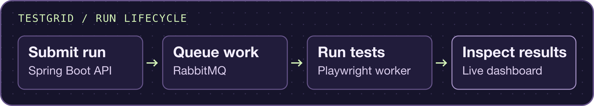

[Portfolio](https://samuel-portfolio-topaz.vercel.app) · [LinkedIn](https://www.linkedin.com/in/samuel-dsouza) · [All repositories](https://github.com/samsaturn007-git?tab=repositories)

## Currently building

### [TestGrid](https://github.com/samsaturn007-git/TestGrid)

A reliability-focused platform for orchestrating browser tests. It queues runs, executes them with Playwright workers, and brings timelines, logs, screenshots, and traces together in a live dashboard.

[Source code](https://github.com/samsaturn007-git/TestGrid) · [Architecture](https://github.com/samsaturn007-git/TestGrid/blob/main/docs/ARCHITECTURE.md) · [Build progress](https://github.com/samsaturn007-git/TestGrid/blob/main/PROGRESS.md)

## Selected projects

| Project | What it does |
| :-- | :-- |
| [**Portfolio**](https://github.com/samsaturn007-git/Portfolio) | Next.js portfolio with three interactive case studies and a procedural Canvas study. [Live site ↗](https://samuel-portfolio-topaz.vercel.app) |
| [**UrbanX**](https://github.com/samsaturn007-git/UrbanX) | React and TypeScript dashboard for traffic, air quality, and city alerts. |
| [**Knee**](https://github.com/samsaturn007-git/Knee) | Expo app that visualizes knee angle and stability readings. |
| [**Finna Credit**](https://github.com/samsaturn007-git/finna-credit-app) | Mobile credit app built with Expo and TypeScript. |
| [**Price Compare**](https://github.com/samsaturn007-git/price-compare-py) | Flask app for comparing electronics prices and viewing price history. |

### Case studies

[Arthik360](https://samuel-portfolio-topaz.vercel.app/work/arthik360) · [Smart X](https://samuel-portfolio-topaz.vercel.app/work/smart-x) · [Smart City Management AI](https://samuel-portfolio-topaz.vercel.app/work/smart-city)

## Achievements & leadership

| Recognition | Event or organization |
| :-- | :-- |
| **First place** | DBIT CodeVerse, Mumbai |
| **Grand finalist** | Smart India Hackathon 2025 |
| **Runner-up** | PVG Pune Hackathon |
| **Creative Head** | Computer Society of India |
