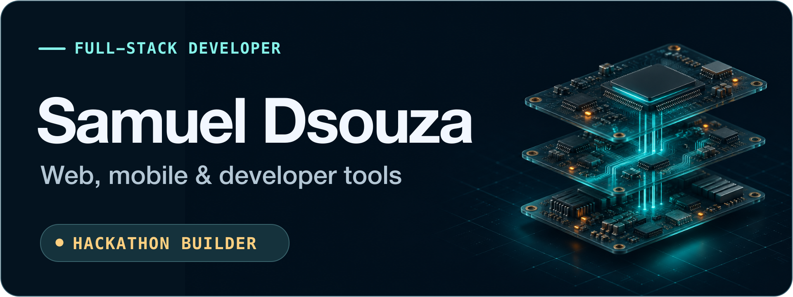
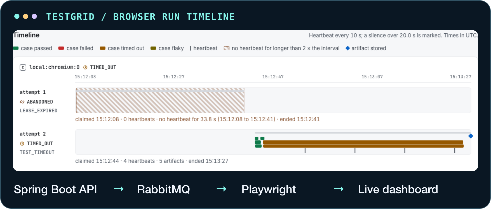
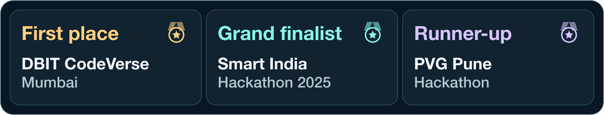
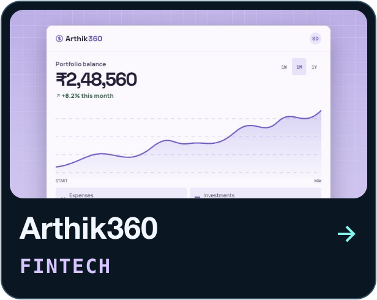
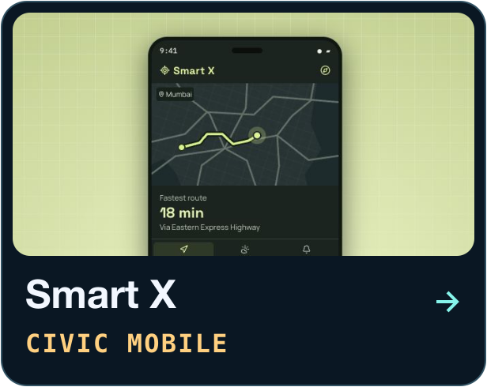
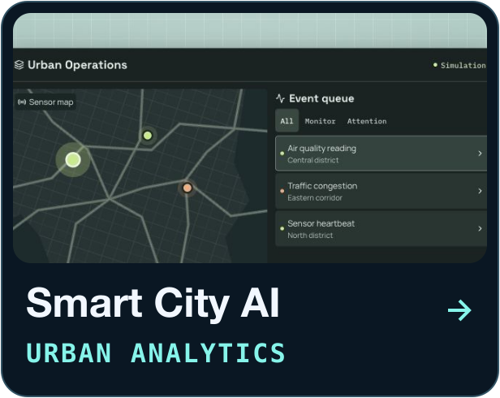
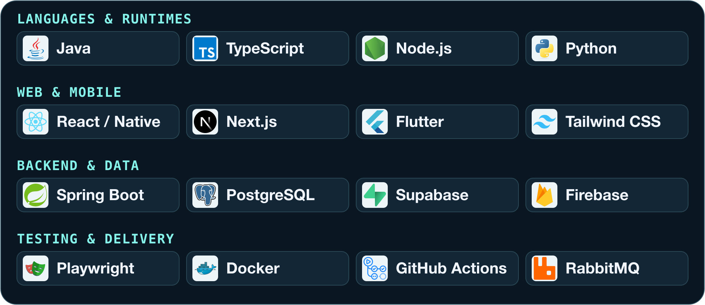

[Portfolio](https://samuel-portfolio-topaz.vercel.app) · [LinkedIn](https://www.linkedin.com/in/samuel-dsouza) · [Hackathons](#hackathons) · [Tech stack](#tech-stack)

## Currently building

### [TestGrid](https://github.com/samsaturn007-git/TestGrid)

I’m building a browser test orchestration platform with a durable queue, Playwright workers, and a live dashboard for run timelines, logs, screenshots, and traces.

[Repository](https://github.com/samsaturn007-git/TestGrid) · [Architecture](https://github.com/samsaturn007-git/TestGrid/blob/main/docs/ARCHITECTURE.md) · [Build progress](https://github.com/samsaturn007-git/TestGrid/blob/main/PROGRESS.md)

## Hackathons

I enjoy teaming up around a real problem, building under a deadline, and demoing something people can try.

<picture>
  <source media="(max-width: 767px)" srcset="https://raw.githubusercontent.com/samsaturn007-git/samsaturn007-git/main/assets/showcase/hackathons-mobile.png">
  
</picture>

**Community leadership** · Creative Head, Computer Society of India (CSI)

## Selected projects

  
  
  

- **[Arthik360](https://samuel-portfolio-topaz.vercel.app/work/arthik360)** brings expenses, assets, and investment performance into one dashboard. Built during my full-stack internship at Genofin Labs with React, Node.js, and Firebase.
- **[Smart X](https://samuel-portfolio-topaz.vercel.app/work/smart-x)** is an Android app for traffic routing, air-quality readings, public alerts, and citizen reports. Built with React Native, TypeScript, and Supabase.
- **[Smart City Management AI](https://samuel-portfolio-topaz.vercel.app/work/smart-city)** brings IoT sensor readings and urban alerts into an operations dashboard connected to Smart X.

[Portfolio source](https://github.com/samsaturn007-git/Portfolio) · [UrbanX](https://github.com/samsaturn007-git/UrbanX) · [Knee](https://github.com/samsaturn007-git/Knee) · [Finna Credit](https://github.com/samsaturn007-git/finna-credit-app) · [Price Compare](https://github.com/samsaturn007-git/price-compare-py) · [All repositories](https://github.com/samsaturn007-git?tab=repositories)

## Tech stack

<picture>
  <source media="(max-width: 767px)" srcset="https://raw.githubusercontent.com/samsaturn007-git/samsaturn007-git/main/assets/showcase/stack-mobile.png">
  
</picture>

## Experience

- **Genofin Labs** · Full-stack web development intern, June–August 2025. Built Arthik360 and integrated identity verification, investment data, and interactive charts.
- **TechEntrepreneurs** · Mobile application development intern, March–June 2025. Worked on cross-platform iOS and Android apps with React Native and Flutter.
